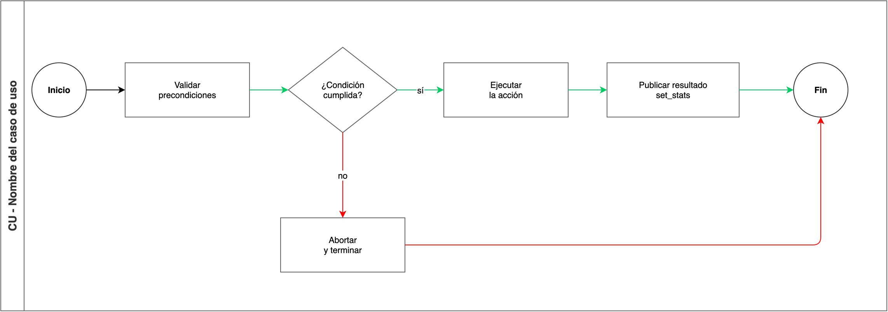

# Casos de uso

Plantilla de la documentación de un caso de uso de **Ansible Automation Platform (AAP)**. Sustituya cada marcador `<...>` por el dato del caso. Elimine la sección que no aplique. No deje nombres, playbooks ni valores de otro proyecto.

Un README puede agrupar varios casos de uso. Cada caso es un título de nivel 2 y entra en el contenido.

Los datos de entrada se preparan con [como_suministrar_informacion.md](como_suministrar_informacion.md). El diagrama de ejemplo está en esta misma carpeta.

## Contenido

- [Nombre del caso de uso](#nombre-del-caso-de-uso)

## Nombre del caso de uso

### Descripción del Caso de Uso

Este caso de uso automatiza `<objetivo>`, utilizando **Ansible Automation Platform (AAP)**. La automatización `<qué hace de principio a fin>`.

`<Si el flujo tiene un camino de fallo, descríbalo en una frase. Si no lo tiene, borre esta frase.>`

### Pre-requisitos

- Accesos con privilegios a las consolas de:

  - `<sistema>`

- `<requisito de red, inventario, paquete o catálogo>`
- Inventario de ejecución: `<inventario>`

### Actividades

| **Tareas** | **Estado** | **Responsable** |
|:-----------|:-----------|:----------------|
| `<tarea>` | `<Definido / Pendiente>` | `<Cliente / Red Hat>` |

### Resumen de Pasos Automatizados

Un apartado por nodo, en el orden del workflow. El título lleva el nombre del paso y la ruta del playbook. Cada viñeta es una acción observable. Si dos nodos corren a la vez, indíquelo en el primer apartado del grupo.

#### `<Nombre del paso>` (`playbooks/<playbook>.yml`)

- `<acción>`
- `<variable que publica para el nodo siguiente, si la hay>`

#### `<Nombre del paso de fallo>` (`playbooks/<playbook_rollback>.yml`)

Se ejecuta cuando falla el paso anterior.

- `<acción de cierre o reversa>`

### Distribución de Archivos

Incluya solo archivos de este caso de uso. El diagrama y su fuente quedan en la misma carpeta que este README. Agregue `files/`, `templates/`, `vars/` o `test/` solo si el caso los usa.

```bash
.
├── README.md
├── como_suministrar_informacion.md
└── files
    ├── images
    │   └── ejemplo_flujo.png
    └── sources
        └── ejemplo_flujo.drawio
```

### Construcción del Execution Environment (EE)

Sección opcional. Inclúyala solo cuando el caso usa un Execution Environment propio.

El Execution Environment incluye `<dependencias: colecciones, paquetes o librerías>`. La definición está en `<ruta/ee.yml>`.

```bash
ansible-builder build -f <ruta/ee.yml> --build-arg TOKEN='<token>' -t <nombre-ee>:<etiqueta>
```

| Argumento | Descripción |
|:----------|:------------|
| `-f <ruta/ee.yml>` | Archivo de definición del EE |
| `--build-arg TOKEN='<token>'` | Token de acceso a Automation Hub. No documente el valor |
| `-t <nombre-ee>:<etiqueta>` | Nombre y etiqueta de la imagen |

### Requisitos y Consideraciones Importantes

- `<acceso, colección, valor por defecto, orden entre nodos o límite del flujo>`
- `<si una opción del survey no tiene tareas, dígalo en una frase>`

#### Collections

```yaml
---
collections:
  - <namespace.collection>
```

#### Playbooks

| YAML | Descripción |
|:-----|:------------|
| `playbooks/<playbook>.yml` | `<qué hace>` |

#### Otros Archivos

| Archivo | Descripción |
|:--------|:------------|
| `<nombre_flujo>.png` | Diagrama del flujo del caso de uso |
| `<nombre_flujo>.drawio` | Fuente editable del diagrama |
| `<ruta/archivo>` | `<para qué sirve>` |

### Recursos en AAP

#### Workflow Template: `<nombre del workflow>`

Inventario: `<inventario>`

Omita esta tabla si el caso es un solo job template.

| Nodo | Nombre | Playbook | Condición |
|:-----|:-------|:---------|:----------|
| 1 | `<job template>` | `playbooks/<playbook>.yml` | Run on success |
| 2 | `<job template de fallo>` | `playbooks/<playbook_rollback>.yml` | Run on fail, desde el nodo 1 |

Los nodos en paralelo comparten número y se distinguen con letra (`3a`, `3b`). La condición usa solo estos términos: `Run on success`, `Run on fail`, `Run always`.

#### Templates

| Nombre | Playbook | Credenciales |
|:-------|:---------|:-------------|
| `<job template>` | `playbooks/<playbook>.yml` | `<tipo>` (`<VAR_ENTORNO>`) |

Si el job usa un Execution Environment con nombre propio, agregue la columna `EE`.

#### Survey

Survey del workflow `<nombre del workflow>`. Omita esta subsección si no hay survey.

| # | Pregunta | Variable | Tipo | Requerida | Valor por defecto | Opciones |
|:--|:---------|:---------|:-----|:----------|:------------------|:---------|
| 1 | `<pregunta>` | `<ev_variable>` | `<Text / Password / Integer / Multiple Choice>` | `<Sí / No>` | `<valor o —>` | `<opciones o —>` |

### Variables

No escriba valores de contraseñas, tokens ni llaves. Documente el nombre de la variable.

#### Extra Vars (entrada por AAP / WFJT)

| Variable | Descripción | Tipo | Usado en |
|:---------|:------------|:-----|:---------|
| `<ev_variable>` | `<descripción. Si el playbook aplica un valor cuando no llega, indíquelo>` | `<String / Integer / Boolean / List / Dict>` | `<playbook>.yml` |

Si la variable no está en el survey, indíquelo: entra como extra var del job template.

#### Variables de credencial (entorno del job)

| Variable | Descripción | Usado en |
|:---------|:------------|:---------|
| `<SISTEMA_PASSWORD>` | `<qué autentica>` | `<playbook>.yml` |

#### Variables Fijas (definidas en el playbook)

| Variable | Descripción | Tipo | Definida en |
|:---------|:------------|:-----|:------------|
| `<variable_fija>` | `<descripción>` | `<String>` | `<playbook>.yml` |

#### Variables Dinámicas (set_fact / set_stats)

| Variable | Descripción | Tipo | Definida en |
|:---------|:------------|:-----|:------------|
| `<variable_publicada>` | `<qué publica al workflow y qué nodo la consume>` | `<String>` | `<playbook>.yml` |

### Referencia

Sección opcional. Úsela para una tabla propia del caso, por ejemplo ambientes, cápsulas o un catálogo. Si no hay tabla, elimínela.

| `<clave>` | `<valor>` |
|:----------|:----------|
| `<clave>` | `<valor>` |

`<Una frase sobre cómo se elige la fila, si aplica.>`

### Diseño

El diagrama y la imagen exportada viven en la misma carpeta que este README. En el caso real, sustituya el ejemplo por `<nombre_flujo>.png` y `<nombre_flujo>.drawio`.



Fuente: `ejemplo_flujo.drawio`

Convención del diagrama:

- Elipse: inicio y fin
- Rectángulo: paso del workflow
- Rombo: decisión
- Flecha verde: camino de éxito (`Run on success`)
- Flecha roja: camino de fallo (`Run on fail`)
- Sin relleno. El título del recuadro es `CU - <nombre del caso de uso>`
- Si hay pasos en paralelo, van dentro de un recuadro con el texto `En paralelo`
